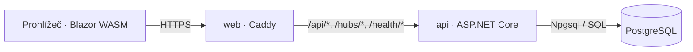

# Architektura a API

Caddy obsluhuje statický web a předává backendové požadavky API; v `Development` také `/openapi/*`.

| Umístění | Odpovědnost |
| --- | --- |
| [Portal.Web](../src/Portal.Web/) | Stránky, HTTP klient, přihlášení v paměti |
| [Portal.Api](../src/Portal.Api/) | `Auth`, `Companies`, `Jobs`, `Chat`, `Health`; SQL a autorizace |
| [Portal.Contracts](../src/Portal.Contracts/) | Sdílené request/response DTO a validace |
| [Database](../Database/) | Schéma a počáteční role |
| [deploy/Caddyfile](../deploy/Caddyfile) | HTTPS, směrování, obsluha WASM |

## Rozhraní

| Metoda a cesta | Přístup | Výsledek |
| --- | --- | --- |
| `POST /api/auth/register` | Veřejný | `201` + JWT; duplicitní e-mail `409` |
| `POST /api/auth/login` | Veřejný | `200` + JWT; nesprávné údaje `401` |
| `GET /api/auth/me` | JWT | Aktivní vlastní účet; jinak `401` |
| `POST /api/companies` | Aktivní účet `company` | Firma a členství zakladatele `owner` v jedné transakci; `201` + detail, duplicita registračního čísla v zemi `409` |
| `GET /api/companies` | JWT `company` | Firmy s vlastním aktivním členstvím a aktivním firemním účtem |
| `GET /api/companies/{companyId}` | Aktivní účet `company` a členství | Firma a vlastní členství; nepřístupná či neexistující firma `404` |
| `POST /api/companies/{companyId}/jobs` | Aktivní účet `company` a členství | Nový koncept nabídky; `201` + detail pro správu |
| `PUT /api/companies/{companyId}/jobs/{jobId}` | Aktivní účet `company` a členství | Nahrazení editovatelných údajů konceptu; jiný stav `409` |
| `GET /api/companies/{companyId}/jobs?offset=0&limit=20` | Aktivní účet `company` a členství | Nabídky vlastní firmy ve všech stavech |
| `GET /api/companies/{companyId}/jobs/{jobId}` | Aktivní účet `company` a členství | Detail nabídky pro správu; cizí či neexistující nabídka `404` |
| `GET /api/jobs?offset=0&limit=20` | Veřejný | Zveřejněné nabídky s neuplynulým nebo neurčeným deadlinem |
| `/hubs/chat` (SignalR) | JWT | Připojení; metody pro zprávy zatím chybí |
| `GET /health/live` | Veřejný | Běh procesu |
| `GET /health/ready` | Veřejný | Spojení s DB a přítomnost obou rolí; při chybě `503` |
| `GET /openapi/v1.json` | Jen Development | OpenAPI JSON |

- JSON: `camelCase`; validační a aplikační chyby: Problem Details.
- Nabídky: `offset ≥ 0`, `limit 1–100`; neplatné hodnoty → `400`.
- Přesné datové kontrakty: [AuthContracts.cs](../src/Portal.Contracts/Auth/AuthContracts.cs), [JobOfferResponse.cs](../src/Portal.Contracts/Jobs/JobOfferResponse.cs).

## Přihlášení a oprávnění

- Hesla: ASP.NET Core `PasswordHasher` (PBKDF2).
- JWT: HS256, výchozí platnost 30 minut; role `candidate` / `company`.
- Registrace a login vracejí `accessToken`, `expiresAt`, `user`.
- HTTP hlavička: `Authorization: Bearer <accessToken>`.
- SignalR přijímá `access_token` v query pouze pod `/hubs/chat`; tokeny nelogovat.
- Web drží token v paměti; odhlášení jej odstraní, vydaný JWT serverově nezneplatní. Refresh tokeny nejsou implementované.
- Endpointy standardně vyžadují přihlášení; veřejné mají explicitní výjimku.

## Pravidla pro další vývoj

- Přístup k datům ověřovat v API podle vlastníka nebo aktivního členství ve firmě; role sama nestačí.
- SQL je parametrizované přes Npgsql; ORM ani automatické migrace nejsou zavedené.
- Soubory ukládat soukromě mimo web root; klientům zpřístupňovat přes autorizované API.
- AI volat z backendu; klíče nepatří do WASM klienta.
