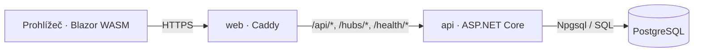
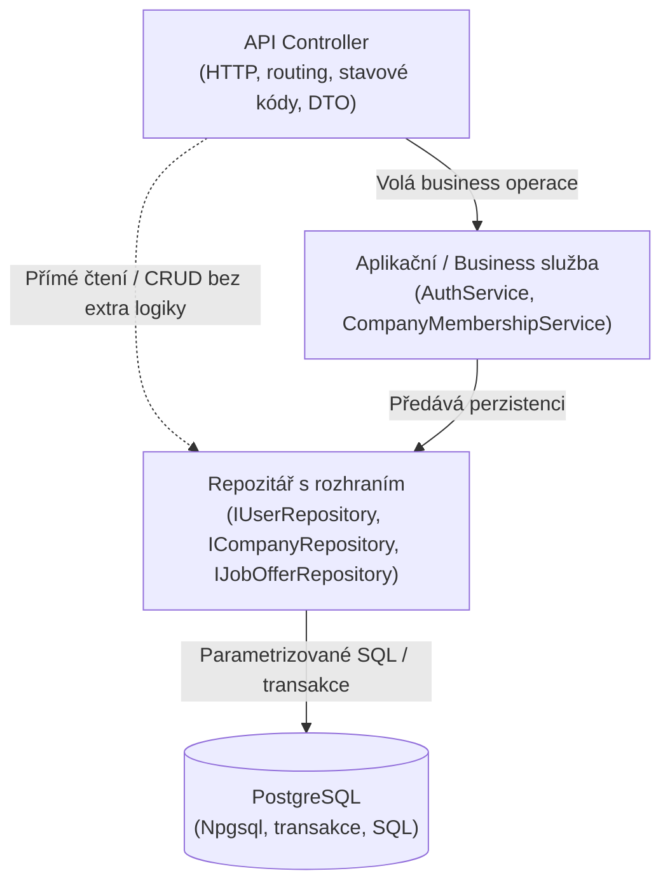

# Architektura a API

Caddy obsluhuje statický web a předává backendové požadavky API; v `Development` také `/openapi/*` a `/swagger/*`.

| Umístění | Odpovědnost |
| --- | --- |
| [Portal.Web](../src/Portal.Web/) | Stránky, HTTP klient, přihlášení v paměti |
| [Portal.Api](../src/Portal.Api/) | Web API: Controllery, aplikační služby (`AuthService`, `CompanyMembershipService`), repozitáře (`IUserRepository`, `ICompanyRepository`, `IJobOfferRepository`), SignalR hub a health checky |
| [Portal.Contracts](../src/Portal.Contracts/) | Sdílené request/response DTO a validační modely |
| [Database](../Database/) | Schéma a počáteční role |
| [deploy/Caddyfile](../deploy/Caddyfile) | HTTPS, směrování, obsluha WASM |

## Struktura vrstev backendu (`Portal.Api`)

V rámci refaktorizace byla oddělena aplikační a databázová logika z controllerů do samostatných vrstev:

1. **API Controllery** (`*Controller.cs`):
   - Odpovídají výhradně za HTTP vrstvu: routování, čtení claims z JWT kontextu (`sub`), autorizační politiky a mapování stavových kódů (např. Problem Details pro `400`, `401`, `403`, `404`, `409`).
   - Neobsahují žádné SQL příkazy ani přímou správu transakcí.

2. **Aplikační služby** (`AuthService`, `CompanyMembershipService`):
   - Zapouzdřují business operace a validační logiku vyžadující koordinaci více komponent (např. hashování hesla, re-hashing a vydávání JWT tokenu při loginu/registraci).
   - Zajišťují autorizační kontroly členství firmy před provedením akce.

3. **Repozitáře** (`*Repository.cs` s rozhraními `I*Repository.cs`):
   - Zapouzdřují veškerou SQL komunikaci přes `NpgsqlDataSource` a `NpgsqlCommand`.
   - Spravují explicitní databázové transakce, řádkové zamykání (`FOR UPDATE`, `FOR SHARE`) a řešení konfliktů (`PostgresException` pro unikátní klíče).
   - Vracejí silně typované enumy statusů (např. `RegisterUserStatus`, `CreateCompanyStatus`, `MemberManagementStatus`, `JobUpdateStatus`) pro přesné mapování v controllerech.

## Rozhraní API

| Metoda a cesta | Přístup | Výsledek |
| --- | --- | --- |
## Rozhraní API

| Metoda a cesta | Přístup | Výsledek |
| --- | --- | --- |
| `POST /api/auth/register` | Veřejný | `201` + JWT; duplicitní e-mail `409` |
| `POST /api/auth/login` | Veřejný | `200` + JWT; nesprávné údaje `401` |
| `GET /api/auth/me` | JWT | Aktivní vlastní účet; jinak `401` |
| `GET /api/profiles/me` | Aktivní účet `candidate` | Získání kompletního profilu uchazeče (údaje, praxe, vzdělání) |
| `PUT /api/profiles/me` | Aktivní účet `candidate` | Aktualizace základních údajů a dovedností v profilu; `200` |
| `POST /api/profiles/me/experiences` | Aktivní účet `candidate` | Přidání nové pracovní zkušenosti; `201` |
| `PUT /api/profiles/me/experiences/{id}` | Aktivní účet `candidate` | Úprava pracovní zkušenosti; neexistující `404` |
| `DELETE /api/profiles/me/experiences/{id}`| Aktivní účet `candidate` | Smazání pracovní zkušenosti; `204`, neexistující `404` |
| `POST /api/profiles/me/education` | Aktivní účet `candidate` | Přidání záznamu o vzdělání; `201` |
| `PUT /api/profiles/me/education/{id}` | Aktivní účet `candidate` | Úprava záznamu o vzdělání; neexistující `404` |
| `DELETE /api/profiles/me/education/{id}` | Aktivní účet `candidate` | Smazání záznamu o vzdělání; `204`, neexistující `404` |
| `POST /api/companies` | Aktivní účet `company` | Vytvoření firmy a členství zakladatele `owner` v jedné transakci; `201` + detail, duplicita registračního čísla v zemi `409` |
| `GET /api/companies` | JWT `company` | Seznam firem s vlastním aktivním členstvím a aktivním firemním účtem |
| `GET /api/companies/{companyId}` | Aktivní účet `company` a členství | Firma a vlastní členství; nepřístupná či neexistující firma `404` |
| `POST /api/companies/{companyId}/jobs` | Aktivní účet `company` a členství | Nový koncept nabídky; `201` + detail pro správu |
| `PUT /api/companies/{companyId}/jobs/{jobId}` | Aktivní účet `company` a členství | Nahrazení editovatelných údajů konceptu; jiný stav nabídky `409` |
| `GET /api/companies/{companyId}/jobs?offset=0&limit=20` | Aktivní účet `company` a členství | Nabídky vlastní firmy ve všech stavech |
| `GET /api/companies/{companyId}/jobs/{jobId}` | Aktivní účet `company` a členství | Detail nabídky pro správu; cizí či neexistující nabídka `404` |
| `GET /api/companies/{companyId}/jobs/{jobId}/stages` | Aktivní účet `company` a členství | Náborová kola nabídky podle pořadí |
| `POST /api/companies/{companyId}/jobs/{jobId}/stages` | Aktivní účet `company` a členství | Definice nového kola; `201`, obsazená pozice `409` |
| `PUT /api/companies/{companyId}/jobs/{jobId}/stages/{stageId}` | Aktivní účet `company` a členství | Úprava definice kola; konflikt pozice nebo změna typu použitého kola `409` |
| `DELETE /api/companies/{companyId}/jobs/{jobId}/stages/{stageId}` | Aktivní účet `company` a členství | Smazání nepoužitého kola; `204`, použité kolo `409` |
| `PUT /api/companies/{companyId}/jobs/{jobId}/stages/order` | Aktivní účet `company` a členství | Atomické přeskládání všech kol nabídky na pozice `1..N`; neplatný seznam `400` |
| `GET /api/companies/{companyId}/applications/{applicationId}/stages` | Aktivní účet `company` a členství | Přiřazená kola přihlášky podle pořadí, včetně postupu a výsledků |
| `PUT /api/companies/{companyId}/applications/{applicationId}/stages/{stageId}` | Aktivní účet `company` a členství | Přiřazení kola stejné nabídky; nové `201`, existující `200` beze změny |
| `PATCH /api/companies/{companyId}/applications/{applicationId}/stages/{stageId}/status` | Aktivní účet `company` a členství | Záznam postupu/výsledku kola; neplatný přechod nebo ukončená přihláška `409` |
| `GET /api/companies/{companyId}/applications/{applicationId}/stages/{stageId}/evaluations` | Aktivní účet `company` a členství | Interní HR hodnocení přiřazeného kola |
| `POST /api/companies/{companyId}/applications/{applicationId}/stages/{stageId}/evaluations` | Aktivní účet `company` a členství | Nové hodnocení s volitelným skóre a povinnou poznámkou; `201` |
| `PUT /api/companies/{companyId}/applications/{applicationId}/stages/{stageId}/evaluations/{evaluationId}` | Aktivní účet `company`, členství a autorství | Úprava vlastního hodnocení; cizí autor `403`, ukončená přihláška `409` |
| `GET /api/companies/{companyId}/jobs/{jobId}/stages/{stageId}/slots` | Aktivní účet `company` a členství | Aktivní i neaktivní termíny kola typu pohovor |
| `POST /api/companies/{companyId}/jobs/{jobId}/stages/{stageId}/slots` | Aktivní účet `company` a členství | Nový termín aktivního HR stejné firmy; `201`, překryv `409` |
| `PUT /api/companies/{companyId}/jobs/{jobId}/stages/{stageId}/slots/{slotId}` | Aktivní účet `company` a členství | Úprava termínu nebo jeho reaktivace; překryv či rezervace `409` |
| `DELETE /api/companies/{companyId}/jobs/{jobId}/stages/{stageId}/slots/{slotId}` | Aktivní účet `company` a členství | Deaktivace neobsazeného termínu se zachováním historie; `204`, obsazený `409` |
| `GET /api/applications/{applicationId}/stages/{stageId}/slots` | Aktivní účet `candidate`, vlastní přihláška a přiřazené kolo pohovoru | Dostupné budoucí termíny bez překryvu uchazeče |
| `GET /api/applications/{applicationId}/stages/{stageId}/bookings` | Aktivní účet `candidate`, vlastní přihláška a přiřazené kolo pohovoru | Vlastní rezervace včetně historie zrušení |
| `POST /api/applications/{applicationId}/stages/{stageId}/bookings` | Aktivní účet `candidate`, vlastní přihláška a přiřazené kolo pohovoru | Rezervace dostupného termínu; `201`, duplicita nebo nedostupnost `409` |
| `DELETE /api/applications/{applicationId}/stages/{stageId}/bookings/{bookingId}` | Aktivní účet `candidate`, vlastní rezervace | Zrušení budoucí potvrzené rezervace; `204`, nepovolený stav nebo uplynulý začátek `409` |
| `GET /api/companies/{companyId}/members` | Aktivní účet `company` a členství | Seznam aktivních členství HR týmu |
| `POST /api/companies/{companyId}/members` | Aktivní `owner` nebo `admin` | Přidání existujícího aktivního firemního účtu nebo obnovení členství; `201`, duplicita `409` |
| `PATCH /api/companies/{companyId}/members/{memberId}` | Aktivní `owner` nebo `admin` | Změna role HR na `admin` či `recruiter`; `200` |
| `DELETE /api/companies/{companyId}/members/{memberId}` | Aktivní `owner` nebo `admin` | Deaktivace HR členství se zachováním vazeb; `204` |
| `GET /api/jobs?offset=0&limit=20` | Veřejný | Zveřejněné nabídky s neuplynulým nebo neurčeným deadlinem |
| `/hubs/chat` (SignalR) | JWT | WebSocket připojení; zprávy se připravují |
| `GET /health/live` | Veřejný | Běh procesu API |
| `GET /health/ready` | Veřejný | Spojení s DB a přítomnost rolí `candidate` a `company`; při chybě `503` |
| `GET /openapi/v1.json` | Jen Development | OpenAPI JSON specifikace |
| `GET /swagger` | Jen Development | Swagger UI |

- JSON: `camelCase`; validační a aplikační chyby: Problem Details (`application/problem+json`).
- Nabídky: `offset ≥ 0`, `limit 1–100`; neplatné hodnoty → `400`.
- Datové modely kontraktů: [AuthContracts.cs](../src/Portal.Contracts/Auth/AuthContracts.cs), [CompanyContracts.cs](../src/Portal.Contracts/Companies/CompanyContracts.cs), [JobOfferContracts.cs](../src/Portal.Contracts/Jobs/JobOfferContracts.cs).

## Přihlášení a oprávnění

- Hesla: ASP.NET Core `PasswordHasher<UserResponse>` (PBKDF2) s kontrolou zastaralého hashe a automatickým re-hashem při úspěšném přihlášení.
- JWT: HS256, výchozí platnost 30 minut; role `candidate` / `company`.
- Registrace a login vracejí `accessToken`, `expiresAt`, `user`.
- HTTP hlavička: `Authorization: Bearer <accessToken>`.
- SignalR přijímá `access_token` v query pouze pod `/hubs/chat`.
- Správu HR týmu provádí `owner` nebo `admin`; členství vlastníka je chráněné proti smazání i změně role.

## Pravidla pro další vývoj

- **Dodržovat oddělení vrstev:** Nové controllery nesmí přímo volat SQL. Veškerou databázovou práci směrovat do odpovídajícího repozitáře pod rozhraním (pro snazší mockování a testovatelnost v `Portal.Api.Tests`).
- **Transakce a integrita:** Vícekrokové operace (např. registrace se založením profilu, vytvoření firmy se zakladatelem) řešit v jedné databázové transakci.
- **SQL přístup:** SQL psát parametrizovaně přímo pro Npgsql, bez ORM.
- **Autorizace na úrovni dat:** Vždy v SQL dotazech ověřovat aktivní členství ve firmě a stav účtu (`is_active`), nespoléhat pouze na platnost JWT tokenu.
